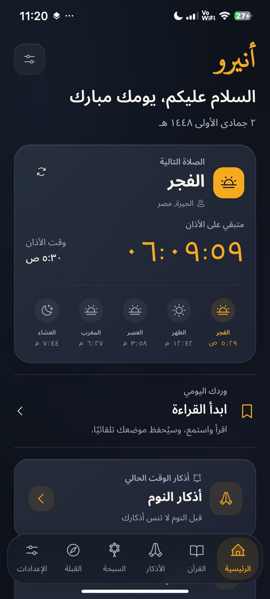
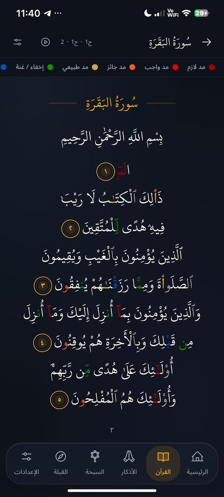
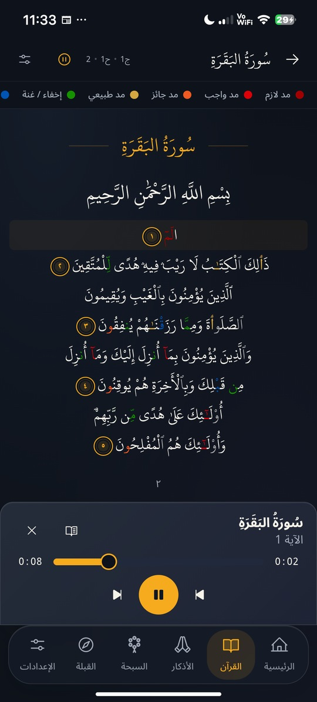
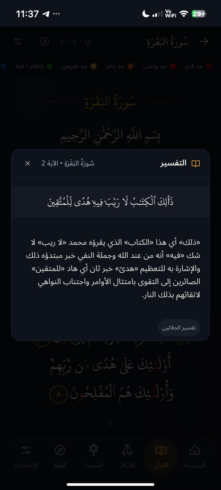
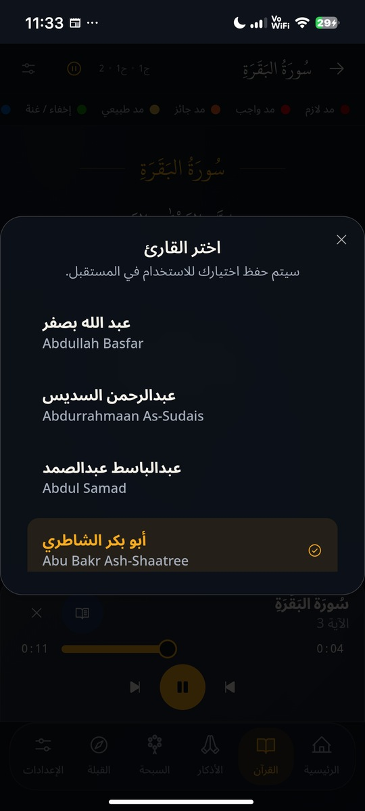
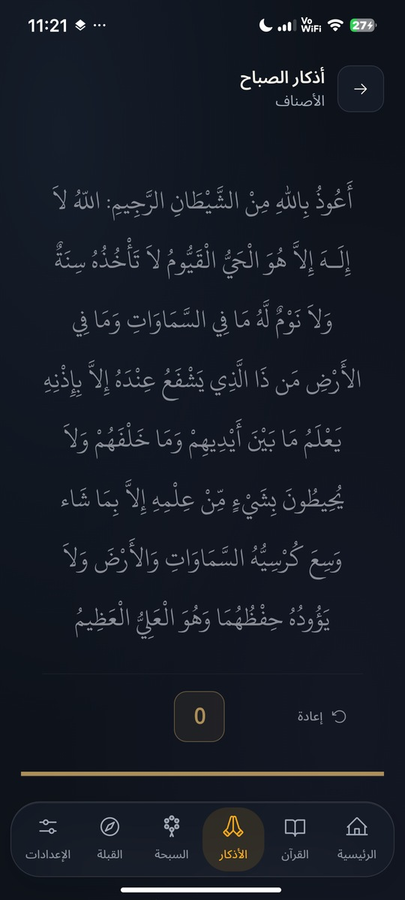
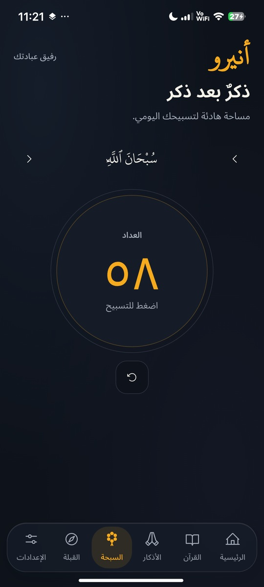
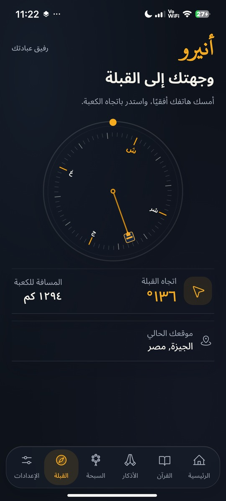

  
  <h1>Aniro</h1>
  
صلاتك، قرآنك، وذكرك. أقرب، كل يوم.

  
Prayer, Quran, and daily remembrance for Android.

  
<a href="https://github.com/its3li/Aniro/releases/latest">Download Android APK</a> · <a href="https://aniro.vercel.app/">Website</a> · <a href="#current-screenshots">Screenshots</a> · <a href="#development">Development</a>

Aniro is an Arabic/English Islamic companion built with Next.js, React,
TypeScript, and Capacitor. The official Android release includes prayer
times and Azan reminders, Quran reading and recitation, Tafseer, daily
Azkar, Tasbeeh, and Qibla.

## Download and update

Get the latest signed APK from [GitHub Releases](https://github.com/its3li/Aniro/releases/latest).
Android 7.0 or newer is required.

**Existing users:** keep Aniro installed. Open Settings → About → Check for
updates, or install the official APK over your existing official version.
The signed update preserves local data and preferences.

**للتحديث:** لا تحذف أنيرو. افتح الإعدادات ← حول التطبيق ← تحقّق من التحديثات،
أو ثبّت ملف APK الرسمي فوق النسخة الحالية واختر «تحديث».

The current release is 6.15, version code 21. Live release metadata is in
[version.json](version.json), including the download URL and APK checksum.

## Current screenshots

These genuine phone captures show the current interface. They replace the
old version-one screenshots previously shown in this README.

| Home and prayer times | Quran reading | Active listening | Tafseer |
| --- | --- | --- | --- |
|  |  |  |  |

| Arabic reciter names | Daily Azkar | Tasbeeh | Qibla |
| --- | --- | --- | --- |
|  |  |  |  |

[Screenshot provenance](assets/screenshots/SOURCES.md): captured from the
owner's phone on October 13, 2026, then resized without stretching or
recreating app content. The app logo is unchanged.

## Features

- **Prayer and Azan:** location-based timings, calculation preferences,
  manual adjustments, and native Android alarms/reminders.
- **Quran:** 114 surahs, page and list reading, color-coded Tajweed,
  saved reading position, and adjustable text controls.
- **Responsive Mushaf:** fits available screen space; larger text remains
  scrollable. The scroll hint appears only when needed and hides after use.
- **Listening and Tafseer:** available reciters, playback controls, and
  verse interpretation inside the reader. Online recitation needs internet.
- **Daily Azkar:** organized categories and repetition tracking; progress
  survives reopening and resets for the next local day.
- **Tasbeeh and Qibla:** a counter with touch feedback and a sensor-based
  compass with calibration guidance.
- **Preferences:** Arabic/English, light/dark/system appearance, text size,
  prayer options, and resizable Android home-screen widgets.
- **Official updates:** APK download, checksum validation, and Android's
  package installer, retaining data for compatible official installs.

Permissions for notifications, alarms, location, and battery behavior can
affect reminders. Review the requested Android permissions during setup.
Sensor availability and calibration affect Qibla direction.

## Technology

| Layer | Technology |
| --- | --- |
| Web app | Next.js 15, React 19, TypeScript 5 |
| UI | Tailwind CSS 3.4, Radix/shadcn components, Phosphor icons |
| Android | Capacitor 8 and native Java plugins |
| Prayer calculations | Adhan libraries |
| Search | MiniSearch, bundled Quran search data |
| Local data | IndexedDB and Capacitor Preferences |

## Development

Requirements: Node.js 20+, Java 21, and the configured Android SDK for
native builds. The app exports static web assets for Capacitor.

    git clone https://github.com/its3li/Aniro.git
    cd Aniro
    npm ci
    npm run dev

Production web build and native sync:

    npm run build
    npx cap sync android

For this Windows workspace, build caches, SDK, and temporary files are kept
on F: using [build-on-f.ps1](scripts/build-on-f.ps1):

    . scripts/build-on-f.ps1
    . scripts/build-on-f.ps1 -Action Release

Provide signing credentials through environment variables or local Gradle
properties. Never commit signing passwords or keystores.

## Checks

    npm run check:release
    npm run check:smoke

Release checks cover Arabic encoding, Tajweed, prayer parity, native Azan,
APK update behavior, search, backend regressions, and TypeScript. Browser
tests include reader layouts across screen sizes, gestures, scroll hints,
daily progress, and update permission/resume behavior.

## Project layout

| Path | Content |
| --- | --- |
| src/app/ | Application pages |
| src/components/ | Shared UI and feature components |
| src/hooks/ | Location, prayer, reading, and state hooks |
| src/lib/ | Data access, calculations, search, and validation |
| android/ | Native Android app and plugins |
| public/ | Bundled static data and web assets |
| assets/screenshots/ | Current README captures |
| tests/ and scripts/ | Browser tests and release checks |

## Contributing and license

Report reproducible problems through [GitHub Issues](https://github.com/its3li/Aniro/issues),
or submit a pull request with a clear description and relevant checks.
Keep private data out of public reports.

MIT license. See [LICENSE](LICENSE).

Made by [Ali Mahmoud](https://github.com/its3li).
